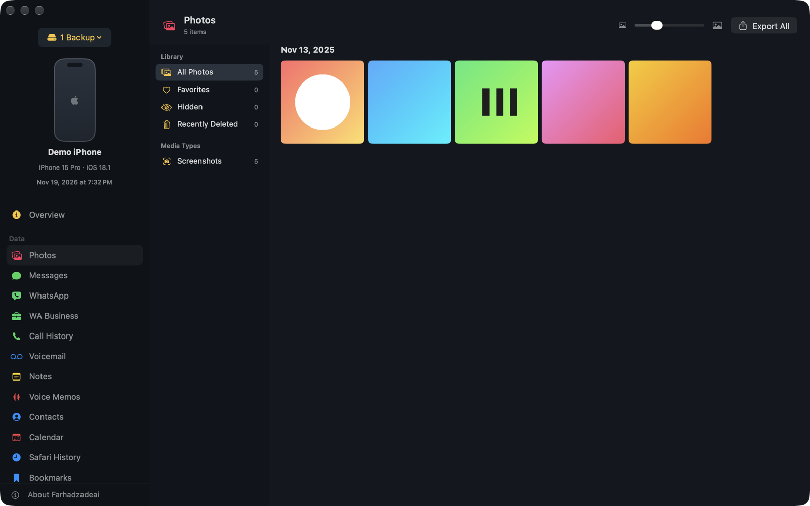

# Apple-BR

**Browse, search and export everything inside your iPhone backups — natively on macOS.**

Apple-BR is a fast, native macOS app that opens local iPhone backups (encrypted or not), decrypts them on-device, and lets you explore every category of data the way Apple's own apps would — photos, messages, contacts, calls, notes, Safari data, apps and the raw file tree — then export whatever you need.




## Download

A prebuilt version is included — no build tools required:

- **[Apple-BR-v1.0.zip](dist/Apple-BR-v1.0.zip)** — macOS 14+, Apple Silicon (arm64), ~2 MB, zero dependencies

The app is ad-hoc signed (not notarized), so the first launch may be blocked by Gatekeeper:

1. Unzip the archive and move `Restor.app` to **Applications** (or anywhere).
2. **Right-click** the app → **Open** → click **Open** again.
   — or run `xattr -dr com.apple.quarantine /Applications/Restor.app` in Terminal.

## Features

- **Open any backup** — from the default `~/Library/Application Support/MobileSync/Backup` folder, any folder you pick, or drag & drop. Works with backups stored anywhere on disk.
- **Encrypted backups** — unlocks iPhone backup keybags with your backup password (PBKDF2 + AES key unwrap, implemented with Apple's CommonCrypto — no third-party crypto).
- **Standard macOS permissions** — uses the regular Open Panel and security-scoped bookmarks so access persists across launches; guides you to Full Disk Access only when needed.
- **Overview** — device name, model, iOS version, serial, UDID, Apple Account, backup date and a storage breakdown.
- **Photos** — grid with day grouping, albums and smart filters (Favorites, Hidden, Videos, Selfies, Live, Portrait, Panoramas, Screenshots, RAW). Quick Look with **Space** (like Apple Photos) — videos auto-play.
- **Messages, WhatsApp & WhatsApp Business** — conversation list with chat bubbles, RTL support, contact names and media.
- **Calls, Voicemail & Voice Memos** — with missed-call detection and inline audio playback.
- **Notes** — both modern (protobuf) and legacy note formats.
- **Contacts** — names, numbers, emails, photos; used for caller-ID throughout.
- **Calendar, Safari History, Bookmarks & Reading List**.
- **Apps** — every installed app with name, version and vendor metadata.
- **File Browser** — the complete backup tree by domain, with search and per-folder export.
- **Export** — per-category exports (CSV, vCard, TXT, media files), *Export All*, or the entire decrypted backup tree.

## Requirements

- macOS 14 (Sonoma) or later, **Apple Silicon (arm64)**
- An iPhone backup created by Finder (or iTunes on older macOS)
- For building from source: the Swift toolchain + Command Line Tools (no Xcode required)

## Build from source

No external dependencies — just the Swift toolchain and Command Line Tools.

```bash
git clone https://github.com/farhadzadeai/Apple-BR.git
cd Apple-BR
./build.sh
open build/Restor.app
```

`build.sh` compiles a release binary, strips symbols, generates the app icon, writes `Info.plist` and produces a signed `build/Restor.app`.

## Usage

1. Back up your iPhone with Finder (**Encrypt local backup** is optional — both work).
2. Launch the app. It lists backups automatically, or use **Choose Backup Folder…** / drag a `.backup` onto the window.
3. For encrypted backups, enter the backup password.
4. Pick a category in the sidebar, browse, and use **Export** when you need the data out.

## How it works

- Parses `Manifest.plist` and decrypts `Manifest.db` using the backup keybag (`BackupKeyBag`) — PBKDF2-HMAC key derivation (SHA-256/SHA-1, iOS 10.2+ scheme) and RFC 3394 AES key unwrapping via CommonCrypto.
- Resolves every file through the manifest's per-file wrapped keys and decrypts on demand with AES-256-CBC.
- Reads app data directly from the decrypted SQLite databases inside the backup.

## Author

**Farhadzadeai** — [farhadzadeai@gmail.com](mailto:farhadzadeai@gmail.com) · [Instagram](https://instagram.com/Farhadzade.ai) · [GitHub](https://github.com/farhadzadeai/Apple-BR)
